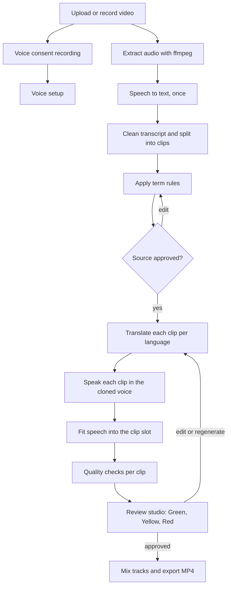
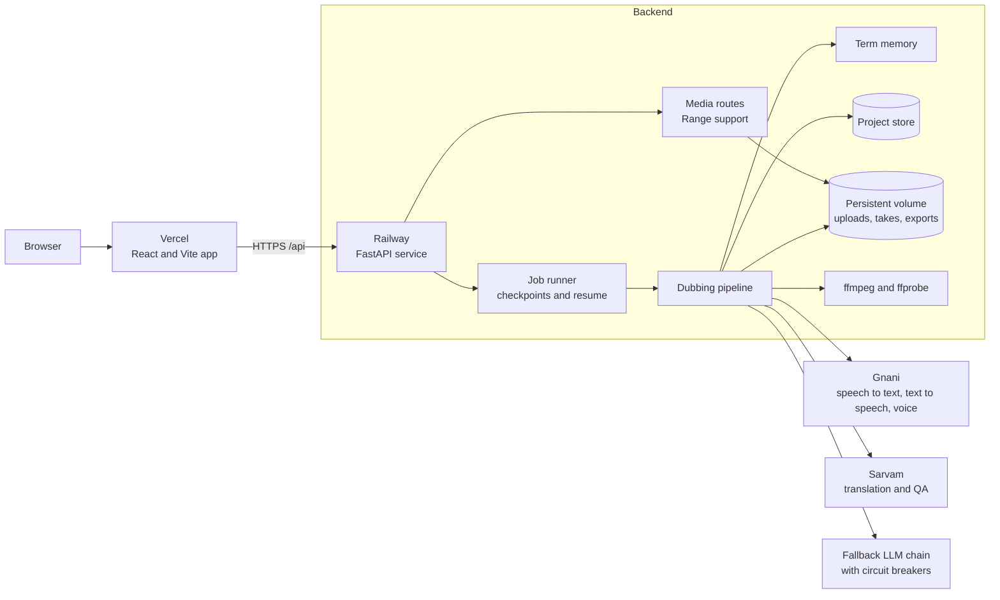
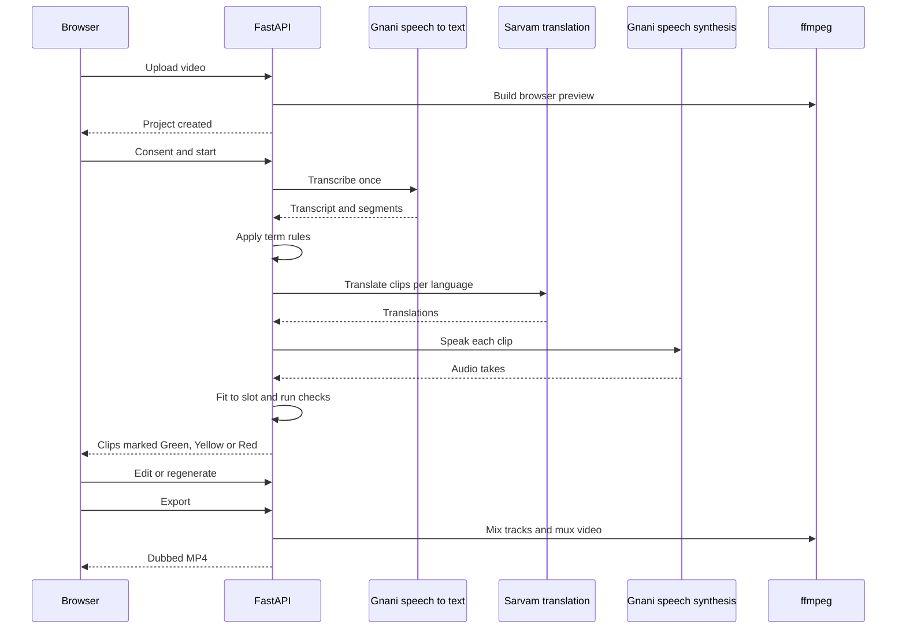
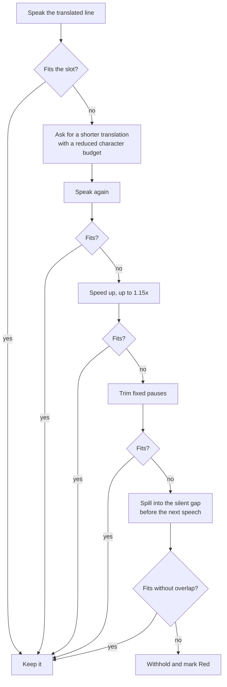
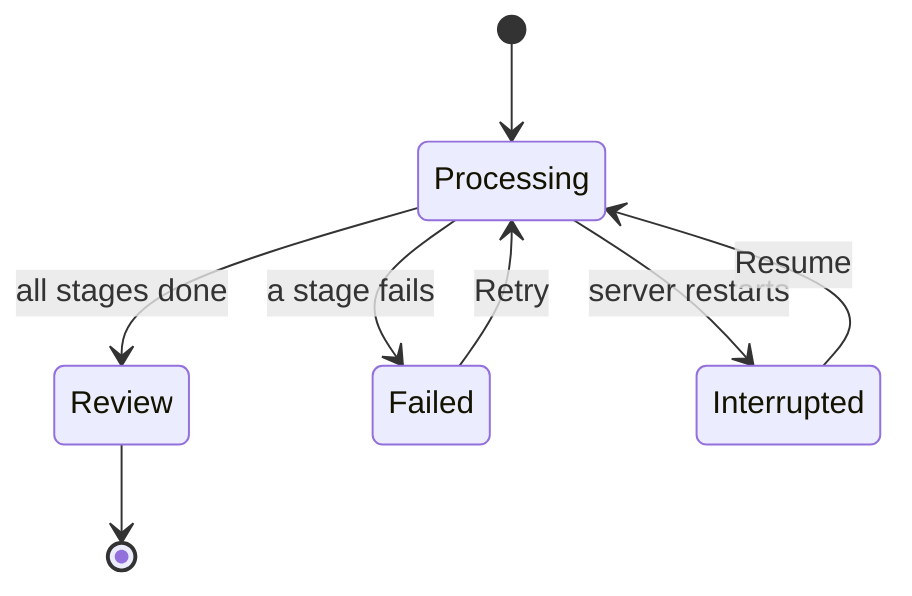

<div align="center">

# Anek

**Speak once. India understands.**

Dub a video into ten Indian languages in your own cloned voice, then review every clip before you export.

[](https://anek-tau.vercel.app)
[](https://anek-tau.vercel.app)
[](pyproject.toml)
[](https://anek-tau.vercel.app)
[](https://railway.com)

[Live app](https://anek-tau.vercel.app) | [Product spec](SPEC.md) | [Evaluation report](EVAL.md)

</div>

---

## Contents

- [About](#about)
- [Demo](#demo)
- [Features](#features)
- [How it works](#how-it-works)
- [Architecture](#architecture)
- [How it is built](#how-it-is-built)
- [Timing and sync](#timing-and-sync)
- [Terms and edits](#terms-and-edits)
- [Reliability](#reliability)
- [Review states](#review-states)
- [Tech stack](#tech-stack)
- [Project structure](#project-structure)
- [Getting started](#getting-started)
- [Testing](#testing)
- [Deployment](#deployment)
- [Limitations](#limitations)
- [Roadmap](#roadmap)
- [Author](#author)

---

## About

Most dubbing tools stop at "translate and speak". The hard part comes after: a name gets mistranscribed, a number changes, a translated line runs longer than the original clip, or two clips talk over each other. Anek treats those as things to catch, not things to hope about.

You upload a video of one speaker. Anek transcribes it, lets you fix names and terms, translates it, speaks each translation in a clone of your voice, fits every line into its original time slot, and marks each clip Green, Yellow or Red so you know exactly where to look before you export.

Supported target languages: Bengali, English, Gujarati, Hindi, Kannada, Malayalam, Marathi, Punjabi, Tamil and Telugu.

## Demo

Demo video coming soon.

<!-- Add the demo video link or embed here once it is recorded. -->

## Features

- **Ten Indian languages** from one upload, in your own cloned voice.
- **One transcription, many languages.** The source is transcribed once and shared across every target.
- **Term memory.** Fix mishearings and protect names so a brand like "Anek" is never translated or mangled.
- **Timing that fits.** Each spoken line is fitted to its clip with a fixed recovery order, and clips never overlap.
- **Clip-by-clip review.** Edit the text, regenerate a clip, compare original and dubbed, and see why a clip was flagged.
- **Resumable jobs.** A restart or crash does not lose the work. Jobs checkpoint and can be resumed.
- **Browser-safe playback.** Video and media are served with HTTP Range support so seeking works.

## How it works



1. **Upload.** MP4, MOV or WebM, up to 120 seconds by default. A browser-safe preview is created with ffmpeg.
2. **Consent and voice.** The speaker records a short consent sample, which is also used to set up the cloned voice.
3. **Transcribe once.** Speech to text runs one time per project. The result is shared by every target language.
4. **Fix terms.** Term rules correct known mishearings and protect names before any translation happens.
5. **Translate.** Each clip is translated for each selected language.
6. **Speak.** Each translation is synthesized in the cloned voice.
7. **Fit.** Each take is fitted into its clip slot, with automatic recovery when it runs long.
8. **Check.** Every clip gets automated checks for meaning, numbers, names, timing and transcript agreement.
9. **Review.** You edit, regenerate or approve clips in the studio.
10. **Export.** Tracks are mixed and muxed back into the video, one MP4 per language.

## Architecture



**Frontend.** A single page React app built with Vite. Every API and media URL goes through one `apiUrl()` helper that adds the `/api` prefix. A build step scans the source and fails if a project video, media or preview URL bypasses that helper.

**Backend.** A FastAPI service that owns projects, jobs, clip review state and media delivery. In the container it also serves the built frontend.

**Pipeline.** Stages for transcription, term fixes, translation, synthesis, timing fit and quality checks. Each stage writes a checkpoint so a job can resume from where it stopped.

**Providers.** Gnani handles speech recognition, synthesis and voice. Sarvam is the primary provider for translation and translation QA. A fallback LLM chain takes over when needed, and a circuit breaker skips any model that fails or runs out of quota for five minutes instead of retrying it on every clip.

**Storage.** Uploads, generated takes, tracks and exports live on a persistent volume. Generated files are written atomically so a crash never leaves a half-written file behind.

### Request flow



## How it is built

A few decisions shape the whole system.

**Transcribe once, translate many.** Transcription is the slowest and most expensive step, and it does not depend on the target language. Running it once and sharing the result across all languages cuts both time and cost.

**Fix the source before translating.** If a brand name is misheard, translating first would copy the mistake into every language. Term rules run on the transcript before translation, so one fix covers all of them.

**Check, do not trust.** Every translated clip is checked for meaning, numbers and names, and timing is measured from the real generated audio instead of estimated. Clips that fail are flagged for a person rather than passed through.

**Recover before rejecting.** When a line runs long, Anek tries several fixes in order before it gives up on a clip. A clip is withheld only when nothing safe remains.

**Fail safe, resume fast.** Hosting platforms restart containers. Jobs checkpoint after each stage, files are written atomically, and an interrupted job can resume without repeating paid work.

**Keep the URL contract honest.** A missing `/api` prefix on a media URL once produced a blank player that looked like a codec bug. The frontend now builds all URLs through one helper and the build fails if that rule is broken.

**Test without paying providers.** Mock modes for the speech and LLM providers let the whole pipeline run in tests, including an end to end smoke test that covers resume after a simulated crash.

## Timing and sync

Hindi, Kannada and most other Indian languages need more syllables than English for the same meaning, so a spoken line often runs longer than the original clip. Anek recovers in a fixed order.



Rules that always hold:

- Speech starts at its source clip start time.
- A small overrun of up to 100 ms is accepted when it fits in detected silence.
- No two clips of speech overlap.
- The final mixed dub duration matches the video within 50 ms, and this is checked.
- Every recovery step is logged, so you can see why a clip was kept or withheld.

This applies to all ten target languages.

## Terms and edits

Term rules can belong to one project or be saved to global memory for future projects.

| Rule | What it does |
| --- | --- |
| Mishearing map | Replaces heard variants of a word with the correct one before translation. |
| Protected term | Is never translated. A placeholder is used during translation, then restored and verified in every output. |
| Spoken spelling | Sets how a protected term is written per language, so the voice says it correctly. |

When you edit text in a clip, you can apply the change to all clips or save it to term memory. Edited clips are locked, so regenerating or re-running a job never overwrites what you wrote.

## Reliability



- **Checkpoints** are saved after transcription, term fixes, each clip and export.
- **Resume** continues from the last checkpoint and does not repeat transcription or finished clips.
- **Atomic writes** keep partial files from ever being served.
- **Media fallback.** If a preview cannot be produced, the app falls back to the original upload and shows a clear reason instead of a blank player.
- **Clear project states.** A project shows Processing with its stage, Interrupted with a Resume button, or Failed with a reason and a Retry button, never an empty Review page.

## Review states

| State | Meaning |
| --- | --- |
| Green | Passed all automated checks. |
| Yellow | Needs a look, for example a transcript mismatch or a missing phrase. |
| Red | A hard failure or uncertain source, for example speech that still cannot fit its slot. |

The studio has an Original and Dubbed toggle, optional side by side playback, per clip slot and character budget details, attempt history, text editing and regeneration.

## Tech stack

| Layer | Tools |
| --- | --- |
| Frontend | React, TypeScript, Vite |
| Backend | Python, FastAPI, Uvicorn |
| Speech to text, speech and voice | Gnani |
| Translation and QA | Sarvam, with a fallback LLM chain |
| Media | ffmpeg and ffprobe |
| Hosting | Vercel for the frontend, Railway for the backend |
| Tests | pytest, plus a frontend build check |

## Project structure

```text
anek/
  backend/
    app.py               FastAPI routes and job orchestration
    atomic_files.py      Durable file writes
    clients/             Speech and LLM provider clients
    pipeline/            Transcription, translation, synthesis, timing
    static/              Built frontend served by the container
  frontend/
    src/main.tsx         React app and apiUrl() helper
    scripts/             Build-time URL prefix check
    vercel.json          Vercel settings and SPA rewrite
  docs/                  Project notes
  scripts/               Helper scripts
  tests/                 Backend tests
  Dockerfile             Backend container
  railway.toml           Railway build and health settings
  pyproject.toml         Python package and test config
  SPEC.md                Product spec
  EVAL.md                Evaluation notes
```

## Getting started

You need Python 3.11 or newer, Node.js 20.19 or newer (or 22.12 or newer), and ffmpeg with ffprobe on your PATH.

```bash
git clone https://github.com/Aarti-panchal01/anek.git
cd anek
cp .env.example .env
```

`.env.example` documents every setting, including a mock mode that runs the app without calling any paid provider. Add real keys only when you want live requests.

Start the backend:

```bash
python -m venv .venv
source .venv/bin/activate        # Windows: .venv\Scripts\Activate.ps1
pip install -e ".[dev]"
uvicorn backend.app:app --reload --port 8000
```

Start the frontend in a second terminal:

```bash
cd frontend
npm ci
npm run dev
```

The Vite dev server proxies `/api` and `/health` to the backend on port 8000.

## Testing

```bash
# backend
python -m pytest tests -q

# frontend: URL prefix check, type check, production build
cd frontend
npm ci
npm run build
```

The backend suite covers the API routes, media validation and Range requests, the timing recovery across all ten languages, term rules, atomic writes, and job interruption and resume. It includes an end to end smoke test that runs Hindi and Kannada with mocked providers and local ffmpeg media.

## Deployment

**Frontend on Vercel.** Set the Root Directory to `frontend`, the Framework Preset to Vite, the Build Command to `npm run build`, and the Output Directory to `dist`. `main` is the production branch.

**Backend on Railway.** `railway.toml` builds the root `Dockerfile`, which installs ffmpeg, serves the built frontend through FastAPI and starts Uvicorn. Mount a persistent volume for uploads, takes and exports. The health check is `/health`.

Pushing to `main` redeploys both. Avoid pushing while a dub is running, because a redeploy restarts the backend container. Interrupted jobs can be resumed, but it is better not to interrupt them.

## Limitations

- Voice cloning quality depends on the length and cleanliness of the reference recording.
- Speech recognition can mishear unusual names. Use term rules to correct known variants.
- One speaker per video.
- Videos are limited to 120 seconds by default.
- Original background sound is replaced, not mixed in. A short room tone sample can be restored.

## Roadmap

- [x] Sarvam translation and QA with fallback providers and circuit breakers
- [x] Timing recovery, silent gap spill and no overlap checks across ten languages
- [x] Project and global term rules, protected terms and edit locking
- [x] Checkpointed jobs, resume after restart and atomic file writes
- [x] Single player toggle, clip editing, attempt history and media URL prefix check
- [ ] Better voice clone quality and a reference audio quality check
- [ ] Demo video
- [ ] Multi speaker support

## Author

Built by [Aarti Panchal](https://aarti-panchal.site).

Speech APIs by Gnani.
