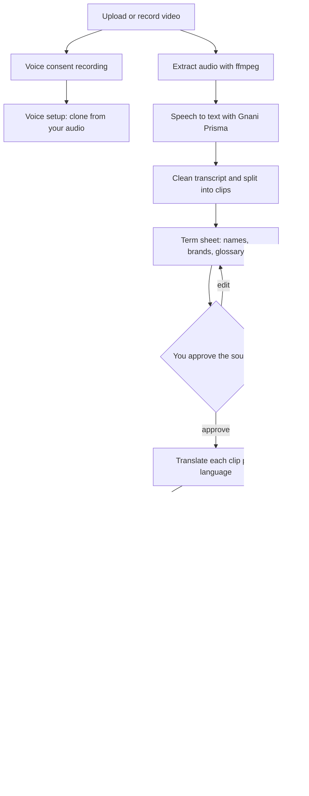
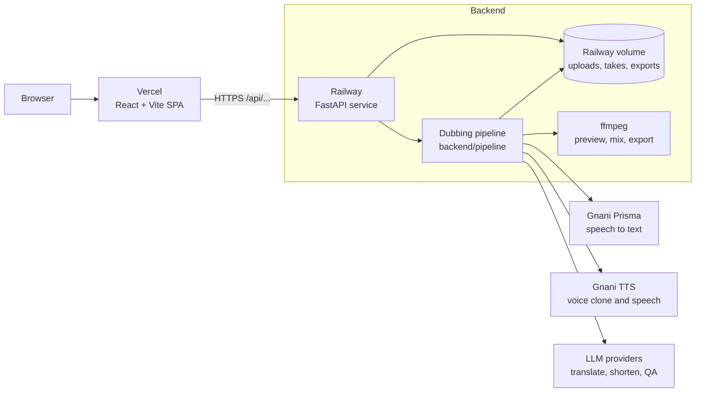
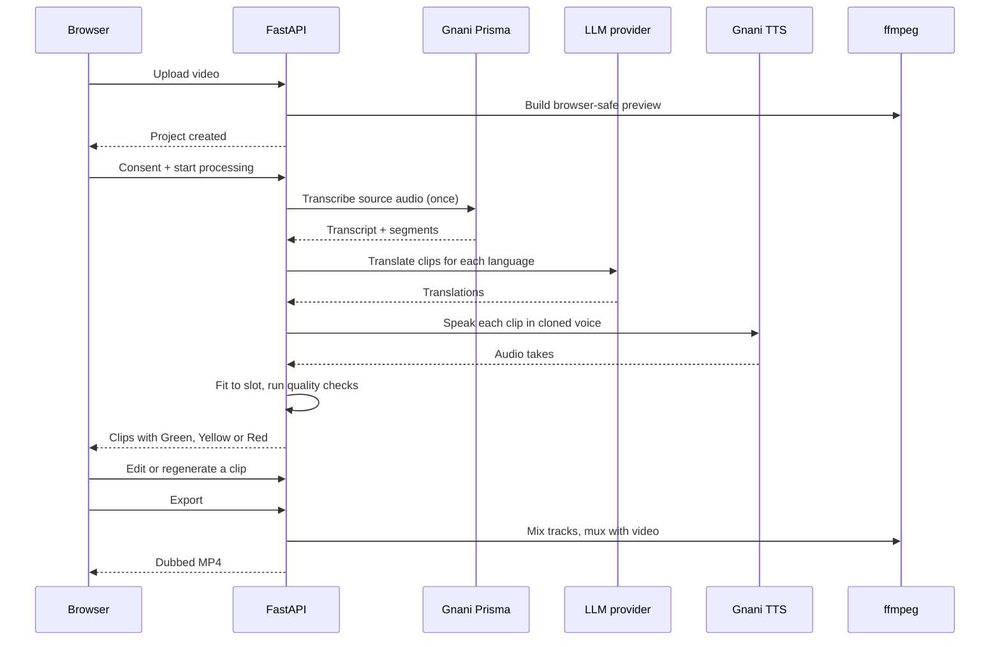
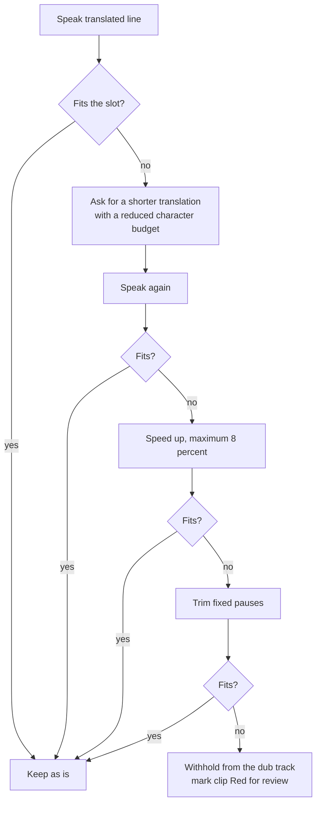

<div align="center">

# anek

**Speak once. India understands.**

Dub your video into ten Indian languages in your own cloned voice, with every clip checked before you publish.

[](https://anek-tau.vercel.app)
[](https://anek-production.up.railway.app)
[](https://anek-tau.vercel.app)
[](https://anek-production.up.railway.app)

[Live demo](https://anek-tau.vercel.app) | [Spec](SPEC.md) | [Eval report](EVAL.md)

</div>


---

## Table of contents

1. [What it does](#what-it-does)
2. [Screenshots](#screenshots)
3. [How a dub is made](#how-a-dub-is-made)
4. [Architecture](#architecture)
5. [Timing fit and recovery](#timing-fit-and-recovery)
6. [Review states](#review-states)
7. [Tech stack](#tech-stack)
8. [Repository layout](#repository-layout)
9. [Run it locally](#run-it-locally)
10. [Environment variables](#environment-variables)
11. [Deployment](#deployment)
12. [Testing](#testing)
13. [Known limitations](#known-limitations)
14. [Roadmap](#roadmap)
15. [Credits](#credits)

---

## What it does

You upload a video of yourself talking. Anek:

1. Listens to the speech and transcribes it.
2. Lets you fix names and terms in a term sheet before anything is translated.
3. Translates the script into up to ten Indian languages.
4. Speaks each translation in a clone of your voice.
5. Fits every spoken line into the time slot of the original clip.
6. Flags anything it is not sure about, so you review it instead of publishing a bad dub.
7. Exports a dubbed MP4 per language.

The point is not just to dub. The point is to make sure the dub is right. Numbers, names, meaning and timing are checked per clip, and clips that fail a check are marked for you instead of being passed through quietly.

## Screenshots

| New dub | Review studio |
| --- | --- |
|  |  |

| Clip review, Hindi | Clip review, Kannada |
| --- | --- |
|  |  |

> Put your screenshots in `docs/images/` with these names. See [docs/images/README.md](docs/images/README.md) if you add one.

## How a dub is made



A few things worth knowing about this flow:

- Transcription runs once per project and is shared across all target languages. It is not repeated per language.
- Nothing is charged until voice consent is given and processing starts.
- The term sheet is applied before translation, so a brand name is fixed in the source and does not get translated wrongly in every language.

## Architecture



**Frontend.** A single page app. Every request, including video and media URLs, goes through one `apiUrl()` helper so the `/api` prefix is never missed. A build step (`check:api-prefix`) fails if a URL is built without it.

**Backend.** A FastAPI service. It owns projects, jobs, the review state of each clip, and serves video and media with HTTP Range support so seeking works.

**Pipeline.** `backend/pipeline` holds the dubbing stages. The LLM client in `backend/clients/llm.py` tries providers in order, backs off failing models, and rotates keys when one hits quota.

**Storage.** Uploads, generated takes and exports live on a mounted Railway volume.

### One request, end to end



## Timing fit and recovery

Hindi, Kannada and most other Indian languages take more syllables than English for the same meaning. So a spoken line often runs longer than the original clip. Anek tries to recover in a fixed order and logs which step worked.



This applies to all ten target languages. Each recovery step writes a `Timing recovery for <lang> clip <n>` line to the server log, so you can see why a clip was kept or withheld.

## Review states

Each clip gets a status so you know where to look first.

| Status | Meaning |
| --- | --- |
| Green (verified) | Passed all checks. |
| Yellow (review) | Passed timing but a check raised a concern, for example a missing phrase in the translation or a transcript mismatch. |
| Red (need you) | Failed a hard check, for example the speech cannot fit its slot, or the source wording is uncertain. |

The studio shows an original and a dubbed player, a per clip editor for the translated text, the generated take, the reasons a clip was flagged, and a history of automatic attempts. You can edit the text, regenerate a clip, or listen to the original, the full dub, or original then dub.

## Tech stack

| Layer | Tools |
| --- | --- |
| Frontend | React, TypeScript, Vite |
| Backend | Python, FastAPI, Uvicorn |
| Speech to text | Gnani Prisma |
| Text to speech and voice cloning | Gnani speech APIs |
| LLM (translate, shorten, QA) | Provider chain with fallback, key rotation and backoff |
| Media | ffmpeg |
| Hosting | Vercel (frontend), Railway (backend and volume) |
| Tests | pytest, plus a frontend build check |

## Repository layout

```text
anek/
  backend/
    app.py              FastAPI app and routes
    clients/            Gnani and LLM clients (llm.py holds the provider chain)
    pipeline/           Dubbing stages (phase3b.py handles synthesis and timing)
  frontend/
    src/main.tsx        App entry, studio UI, apiUrl() helper
    scripts/            check-api-prefix.mjs
    vercel.json         Build, output and SPA rewrite settings
  scripts/              Helper scripts
  tests/                Backend tests
  Dockerfile            Backend image for Railway
  SPEC.md               Product spec
  EVAL.md               Evaluation notes
  eval_report.json      Evaluation results
  .env.example          Environment variable names
```

## Run it locally

You need Python 3.11 or newer, Node.js 20 or newer, and ffmpeg on your PATH.

```bash
git clone https://github.com/Aarti-panchal01/anek.git
cd anek
cp .env.example .env        # then fill in your keys
```

**Backend**

```bash
python -m venv .venv
source .venv/bin/activate    # Windows: .venv\Scripts\activate
pip install -e .
uvicorn backend.app:app --reload --port 8080
```

**Frontend**

```bash
cd frontend
npm ci
npm run dev
```

Set `VITE_API_BASE_URL` to `http://localhost:8080` for local development.

## Environment variables

Only names are listed here. Never commit values. `.env.example` is the source of truth.

| Name | Where | Purpose |
| --- | --- | --- |
| `VITE_API_BASE_URL` | Vercel, frontend | Base URL of the backend, for example the Railway domain. No trailing slash. Read at build time, so redeploy after changing it. |
| Gnani API keys | Railway, backend | Speech to text and text to speech. Exact names are in `.env.example`. |
| LLM provider keys | Railway, backend | One or more keys per provider. Exact names are in `.env.example`. |
| Allowed origins (CORS) | Railway, backend | Must include your Vercel domain. |

## Deployment

**Frontend on Vercel**

| Setting | Value |
| --- | --- |
| Root Directory | `frontend` |
| Framework Preset | Vite |
| Build Command | `npm run build` |
| Output Directory | `dist` |
| Production branch | `main` |

If Root Directory is left at the repo root, Vercel finds no `package.json`, builds nothing, and serves a 404.

**Backend on Railway**

- Built from the `Dockerfile`.
- A volume is mounted for uploads and exports.
- The service listens on port 8080.
- Deploys from `main` through the GitHub integration.

Push to `main` and both services redeploy.

## Testing

```bash
# backend
python -m pytest tests -q

# frontend: checks API prefixes, type checks, then builds
cd frontend
npm run build
```

The frontend build runs `check:api-prefix` first. It fails if any media or API URL is built without the `/api` prefix. Backend tests cover the API routes, Range requests, the preview fallback, and timing recovery across all ten target languages.

## Known limitations

- Voice cloning quality depends on the reference audio. A noisy phone recording gives a more synthetic result than a clean 30 to 60 second sample.
- Speech to text can mishear brand names and unusual terms. Add them to the term sheet before translating.
- LLM free tier quotas can run out, which weakens the shorter translation retry and leaves more clips Red. Use billing enabled keys for real use.
- Only one speaker per video is supported.
- Videos are limited to 120 seconds.
- Original background sound is replaced, not mixed in.

## Roadmap

- [ ] Timing: a small overrun tolerance, and letting a clip run into the silent gap before the next clip when nothing overlaps.
- [ ] Higher speed-up limit on retries for Indic languages.
- [ ] Term correction pass that fixes known mishearings of brand names before translation.
- [ ] Add Sarvam for translation and quality checks, with the current LLM chain as fallback.
- [ ] Studio player: one player with an Original and Dubbed toggle, and side by side that replaces it instead of adding more players.
- [ ] Better voice clone quality and a reference audio quality check at upload.

## Credits

Built by [Aarti Panchal](https://aarti-panchal.site). Speech APIs by Gnani.
