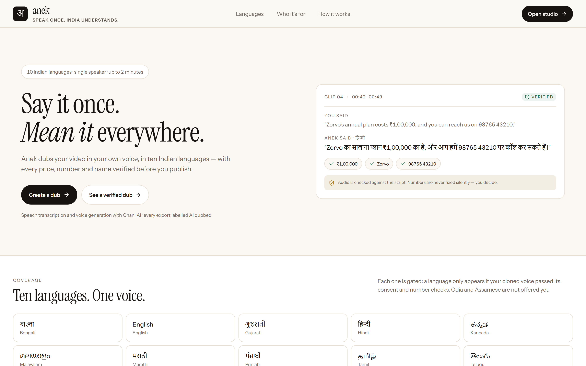
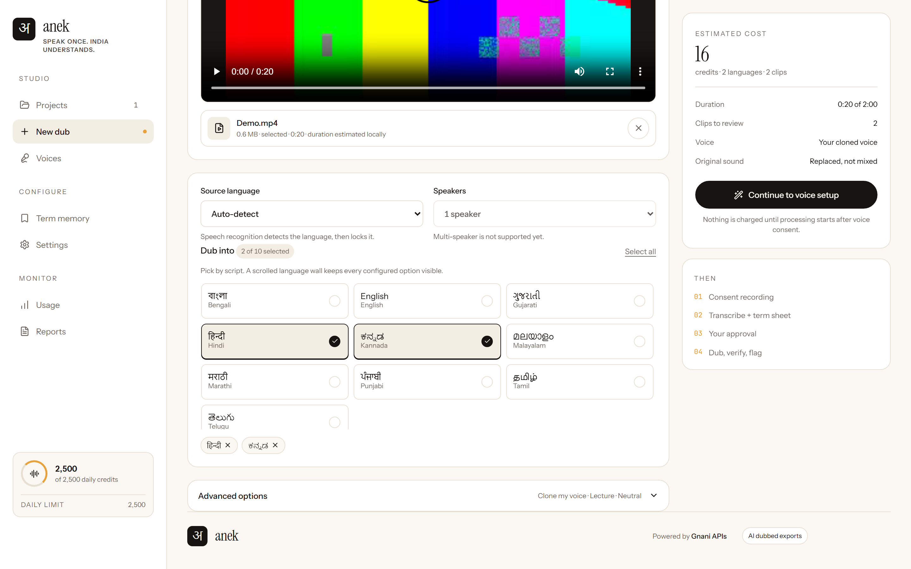
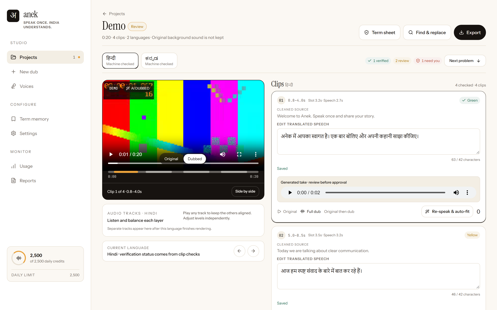
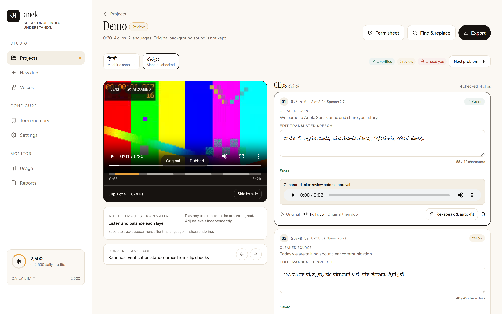
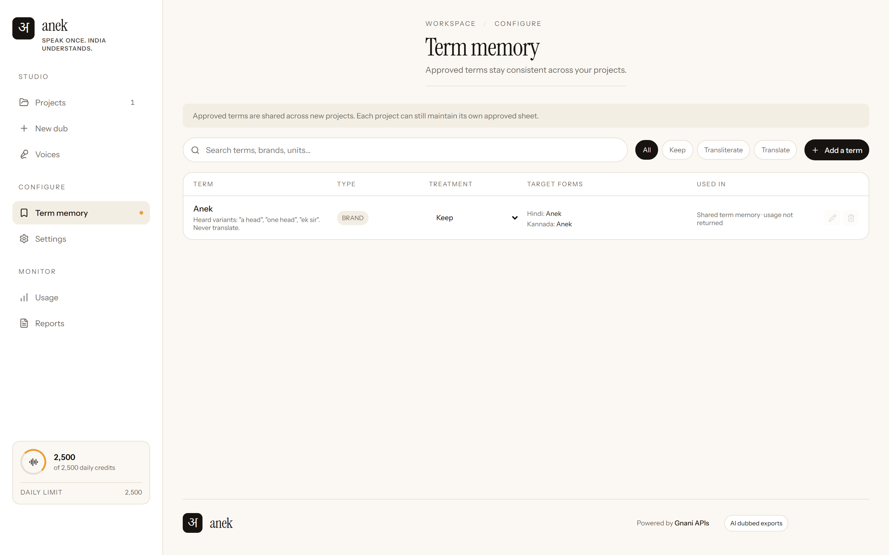
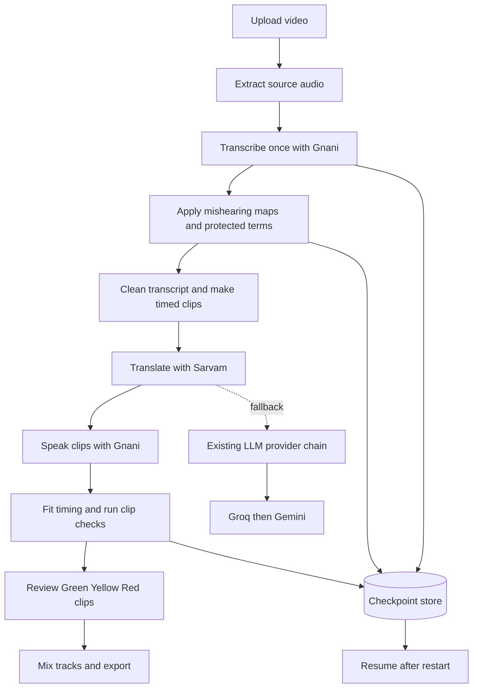
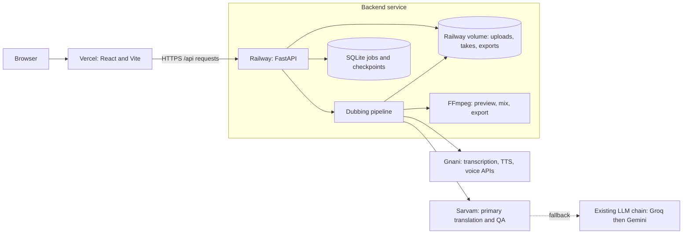

<div align="center">

# Anek

**Speak once. India understands.**

Dub a video into ten Indian languages, review each clip, then export the result.

[Live app](https://anek-tau.vercel.app) | [Product spec](SPEC.md) | [Evaluation report](EVAL.md)

</div>

## What it does

Anek transcribes a video once, applies project terms before translation, creates spoken translations with Gnani speech APIs, and fits each take to its timed clip. The review studio marks clips Green, Yellow, or Red and lets you edit or regenerate them before export.

The supported target languages are Bengali, English, Gujarati, Hindi, Kannada, Malayalam, Marathi, Punjabi, Tamil, and Telugu. The source transcript is shared across targets.

## Screenshots



### New dub



### Review studio


### Clip review





### Term memory



Studio screenshots use seeded demo data. The landing page uses its built-in sample.

## How dubbing works



## Architecture



The frontend builds API and media links through `apiUrl()`, which adds `/api`. The build runs a source scan and fails if project video, media, or preview URLs bypass that helper.

The backend uses atomic writes for generated takes, tracks, video previews, and exports. Jobs save checkpoints for transcription, term fixes, clips, and exports. On restart, a job that was running is marked Interrupted and can be resumed. The project UI shows Processing with its stage, Interrupted with Resume, or Failed with a reason and Retry.

## Translation and timing

Sarvam is the primary translation and translation QA provider. The existing LLM chain is the fallback. Failed models are skipped by a five-minute circuit breaker. Gnani handles speech recognition, synthesis, and voice services.

Speech starts at the source clip's start time. The fitting sequence is:

1. Retry with a shorter translation and reduced character budget.
2. Speed up speech by at most 15 percent, up to 1.15x.
3. Trim fixed pauses.
4. Spill into the detected silent gap before the next speech, when it fits without overlap.
5. Withhold speech only if it still cannot fit safely.

The configured overrun tolerance is 100 ms and is accepted only when it fits in detected silence. No speech clips may overlap. The final mixed dub duration is checked against the video within 50 ms.

## Term memory and edits

Term rules can be project-specific or saved to global memory for future projects. A mishearing map replaces heard variants with the canonical term before translation. Protected terms use placeholders during translation, are restored and checked in every output, and can have a spoken spelling per language for TTS. Edited clips are locked so later generation does not overwrite user text.

## Review states

| State | Meaning |
| --- | --- |
| Green | Passed automated checks. |
| Yellow | Needs review for a quality concern. |
| Red | Needs attention for a hard failure or uncertain source. |

The studio has an Original/Dubbed main-player toggle, optional side-by-side playback, per-clip timing and character-budget details, take history, editing, and regeneration controls.

## Repository layout

```text
anek/
  backend/
    app.py                 FastAPI routes and job orchestration
    atomic_files.py        Durable generated-file helpers
    clients/               Gnani and LLM provider clients
    pipeline/              Transcription, translation, synthesis, timing
    static/                Built frontend served by the backend container
  frontend/
    src/main.tsx            React application and apiUrl() helper
    scripts/check-api-prefix.mjs
    vercel.json             Vercel Vite settings and SPA rewrite
  docs/
    images/                 README screenshots
    PROGRESS.md             Work handoff and task progress
  scripts/                  Local helper scripts
  tests/                    Backend tests
  Dockerfile                Railway container build
  railway.toml              Railway Dockerfile and health settings
  pyproject.toml            Python package and test configuration
  README.md
```

## Run locally

Requirements: Python 3.11 or newer, Node 20.19 or newer in the 20.x line or Node 22.12 or newer (the Vite version in the lockfile declares these ranges), and FFmpeg with ffprobe on `PATH`.

```bash
git clone https://github.com/Aarti-panchal01/anek.git
cd anek
cp .env.example .env
```

Set `GNANI_MOCK=1` and `LLM_MOCK=1` in `.env` for local mock mode. Set actual service keys only when you intend to make live requests.

Start the backend on port 8000. The Vite development proxy forwards `/api` and `/health` to this port.

```bash
python -m venv .venv
# macOS or Linux
source .venv/bin/activate
# Windows PowerShell
.venv\Scripts\Activate.ps1
pip install -e ".[dev]"
uvicorn backend.app:app --reload --port 8000
```

In a second terminal:

```bash
cd frontend
npm ci
npm run dev
```

For a deployed frontend build, `VITE_API_BASE_URL` is read at build time from `import.meta.env`. Set it to the backend origin, with or without a trailing `/api`; `apiUrl()` normalizes the value and adds `/api` to API paths. For local Vite development, leave it unset to use the proxy.

## Environment variables

Names and purposes only. `.env.example` lists the application settings; `PORT` is supplied by Railway. Set backend variables on Railway. The frontend uses only `VITE_API_BASE_URL` on Vercel.

### Vercel

| Name | Purpose |
| --- | --- |
| `VITE_API_BASE_URL` | Backend origin used while building the frontend. Set to the Railway service origin. |
| `VERCEL` | Set automatically by Vercel; selects `dist` as the Vite build output. |

### Railway

| Name | Purpose |
| --- | --- |
| `PORT` | Railway-assigned HTTP port; the container defaults to 8080 when unset. |
| `APP_NAME` | Application display/configuration name. |
| `ANEK_DATA_DIR` | Persistent data root; mount the Railway volume here, normally `/data`. |
| `GNANI_API_KEY` | Gnani speech API authentication. |
| `GNANI_BASE_URL` | Gnani API origin. |
| `STT_MODEL` | Source speech recognition model. |
| `VERIFY_STT_MODEL` | Speech recognition model used for audio verification. |
| `GNANI_DAILY_LIMIT` | Daily Gnani credit safety limit. |
| `SARVAM_API_KEY` | Sarvam authentication for translation and QA. |
| `SARVAM_TRANSLATION_MODEL` | Sarvam translation model configuration. |
| `SARVAM_REWRITE_MODEL` | Sarvam rewrite and QA model configuration. |
| `LLM_BASE_URL` | OpenAI-compatible primary fallback endpoint. |
| `LLM_MODEL` | Model name for the primary fallback endpoint. |
| `GROQ_API_KEYS` | Comma-separated Groq key pool for fallback calls. |
| `LLM_API_KEY` | Single-key fallback when the Groq key pool is empty. |
| `LLM_2_API_KEYS` | Comma-separated keys for the final Gemini fallback pool. |
| `LLM_2_BASE_URL` | Gemini OpenAI-compatible endpoint. |
| `LLM_2_MODEL` | First model in the final Gemini fallback chain. |
| `LLM_CACHE_PATH` | Optional SQLite cache path for LLM responses. |
| `NUMERAL_STYLE` | Numeral formatting preference in generated speech text. |
| `MAX_VIDEO_SECONDS` | Maximum accepted video duration. |
| `MAX_CREDITS_PER_JOB` | Optional per-job credit cap; zero disables this cap. |
| `ENABLED_LANGS` | Comma-separated enabled language codes. |
| `LOW_TRUST_VERIFY_LANGS` | Comma-separated languages requiring stricter audio verification. |
| `FIT_TOLERANCE` | Speech-to-slot fit ratio used by the timing checks. |
| `MAX_STRETCH` | Configured stretch ratio for timing fit. |
| `SIMILARITY_THRESHOLD` | Similarity threshold for source and consent checks. |
| `CONSENT_MATCH_THRESHOLD` | Minimum consent match score. |
| `REQUIRE_ACCESS_AUTH` | Enables access-password authentication when true. |
| `ANEK_ACCESS_PASSWORD` | Optional password for app access. |
| `ANEK_AUTH_SECRET` | Signing secret for access-auth sessions. |
| `CORS_ORIGINS` | Comma-separated allowed browser origins; include the deployed Vercel domain. |
| `CORS_ORIGIN_REGEX` | Optional regular expression for allowed browser origins. |
| `GNANI_MOCK` | Uses mock Gnani responses when enabled. |
| `LLM_MOCK` | Uses mock LLM responses when enabled. |
| `PER_IP_LIMITS` | Per-IP hourly request limits by operation. |

The Railway CORS origin must match the Vercel site origin, including the scheme and hostname. Do not include a trailing slash in `CORS_ORIGINS`.

## Deployment

### Vercel frontend

| Setting | Value |
| --- | --- |
| Root Directory | `frontend` |
| Framework Preset | Vite |
| Build Command | `npm run build` |
| Output Directory | `dist` |
| Production branch | `main` |

Set `VITE_API_BASE_URL` for Production and Preview environments as needed. The repository has `frontend/vercel.json`; there is no root-level `vercel.json`.

### Railway backend

Railway is configured by `railway.toml` to build the root `Dockerfile`. The Dockerfile installs FFmpeg, serves the built frontend assets through FastAPI, and starts `uvicorn backend.app:app` on `$PORT` or port 8080. Mount a persistent volume at `/data`, matching `ANEK_DATA_DIR`. The health check is `/health`.

## Tests

From the repository root:

```bash
python -m pytest tests -q
cd frontend
npm ci
npm run build
```

The backend suite includes a mock resilience smoke test for Hindi and Kannada, media validation, timing, and job interruption/resume. It uses deterministic mocked job execution and locally generated FFmpeg media. The frontend build runs `check:api-prefix`, TypeScript checks, and Vite production build.

## Current limitations

- Voice cloning quality depends on the recording quality and length.
- Speech recognition can mishear unusual names. Use the term rules to correct known variants.
- One speaker per video is supported.
- Videos are limited to 120 seconds by default.
- Original background sound is replaced. The pipeline can restore a short room-tone sample.

## Roadmap

- [x] Sarvam translation and QA with fallback providers and model circuit breakers.
- [x] Timing recovery, silent-gap spill, and no-overlap checks across ten languages.
- [x] Project and global term rules, protected terms, and edit locking.
- [x] Checkpointed jobs, restart resume, and atomic generated-file writes.
- [x] Single-player toggle, clip editing, attempts, and media API prefix check.
- [ ] Improve voice-clone quality and add a reference-audio quality check.

## Credits

Built by [Aarti Panchal](https://aarti-panchal.site). Speech APIs by Gnani.
