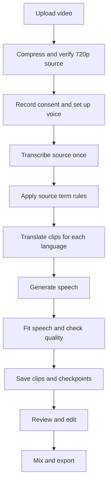
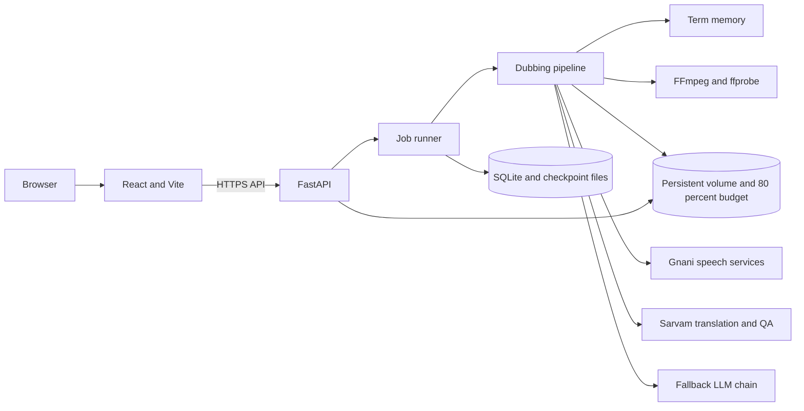
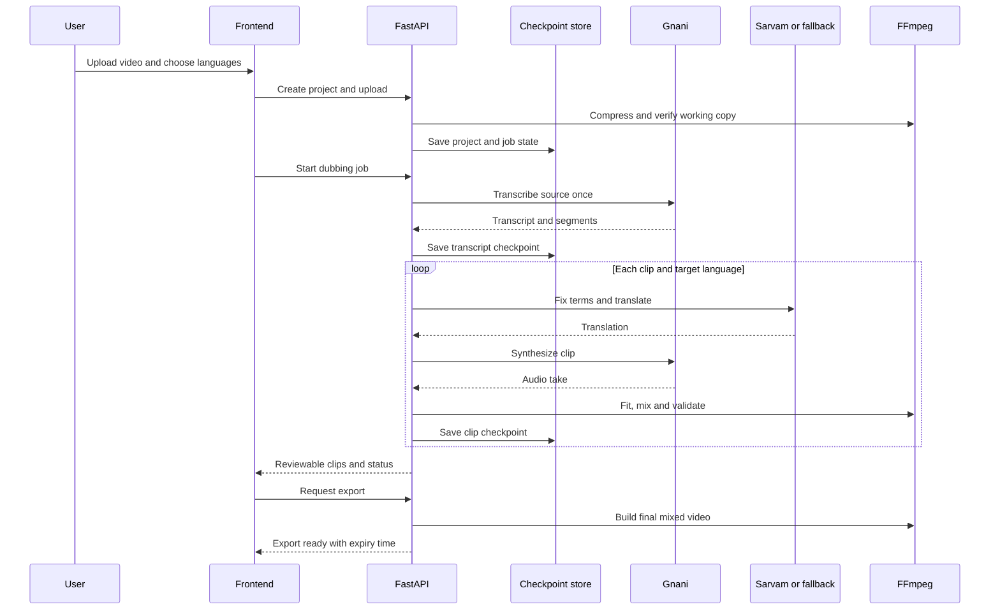
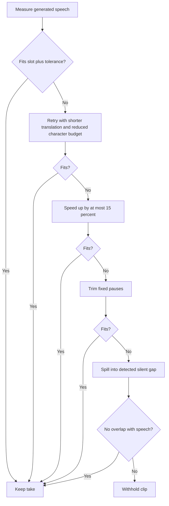
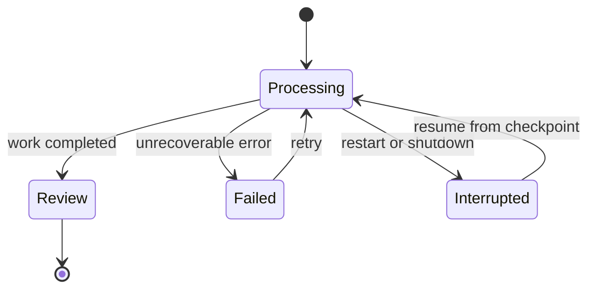

<div align="center">

# Anek

**Speak once. India understands.**

[](https://anek-tau.vercel.app)
[](https://github.com/Aarti-panchal01/anek)
[](pyproject.toml)
[](https://anek-tau.vercel.app)
[](https://railway.com)

[Live app](https://anek-tau.vercel.app) · [SPEC.md](SPEC.md) · [EVAL.md](EVAL.md)

</div>

## Contents

- [About](#about)
- [Demo](#demo)
- [Features](#features)
- [How it works](#how-it-works)
- [Architecture](#architecture)
- [Request flow](#request-flow)
- [How it is built](#how-it-is-built)
- [Timing and sync](#timing-and-sync)
- [Terms and edits](#terms-and-edits)
- [Reliability](#reliability)
- [Review states](#review-states)
- [Tech stack](#tech-stack)
- [Project structure](#project-structure)
- [Getting started](#getting-started)
- [Testing](#testing)
- [Deployment](#deployment)
- [Limitations](#limitations)
- [Roadmap](#roadmap)
- [Author](#author)
- [Credits](#credits)

## About

Anek creates reviewed dubbed versions of a video in ten Indian languages: Bengali, English, Gujarati, Hindi, Kannada, Malayalam, Marathi, Punjabi, Tamil and Telugu. It transcribes the source once, applies term rules, translates and voices each clip, checks timing and quality, then lets a person review the result before export.

## Demo

Demo video coming soon.

<!-- Demo video link goes here. -->

## Features

- Create dubbed tracks in ten target languages with a cloned or selected voice.
- Review clips as Green, Yellow or Red, edit text and regenerate individual takes.
- Use project and global term memory for names and phrases.
- Resume interrupted jobs from saved checkpoints.
- Play original and dubbed video with seeking and synchronized audio.
- Export a mixed MP4 and review report for each language.

## How it works



1. Upload an MP4, MOV or WebM video, up to 40 MB and 120 seconds by default. The server creates and verifies a 720p working copy.
2. Record speaker consent and configure the voice.
3. Transcribe the source once and reuse it across selected languages.
4. Apply mishearing and protected term rules before translation.
5. Translate and synthesize each clip in each target language.
6. Recover over-slot speech, run quality checks and save checkpoints.
7. Review, edit or regenerate clips, then export the final mixed video.

## Architecture



**Frontend.** React and TypeScript run in Vite. API and media URLs use the shared `apiUrl()` helper. A build check rejects project media URLs that bypass the `/api` prefix.

**Backend.** FastAPI serves project, job, review and media endpoints. The container also serves the built frontend.

**Pipeline.** The pipeline transcribes once, applies term rules, translates, synthesizes, fits speech, checks results and exports media. Checkpoints let jobs resume.

**Providers.** Gnani provides speech recognition, synthesis and voice services. Sarvam is primary for translation and QA. The existing LLM chain is fallback. Failed or quota-limited models are skipped by a five-minute circuit breaker.

**Storage.** SQLite stores project and job records. A persistent volume stores uploads, working sources, generated clips and exports. Writes use temporary files, fsync and atomic rename. Storage is budgeted to 80 percent of the volume.

## Request flow



## How it is built

**Transcribe once, translate many.** A source transcript is shared across every target language to avoid duplicate recognition work.

**Fix source terms before translating.** Mishearing maps correct transcript variants before translation, so fixes apply consistently in every language.

**Check, do not trust.** Quality checks compare meaning, names, numbers and timing against generated results.

**Recover before rejecting.** A long take gets a shorter translation attempt, controlled speed-up, pause trimming and safe silent-gap spill before it is withheld.

**Fail safe and resume fast.** Durable checkpoints and atomic files keep work recoverable after a restart. A provider circuit breaker prevents repeatedly calling a failing model.

**Keep API paths consistent.** Frontend requests use `apiUrl()`, and a build-time source scan enforces `/api` for project media and API URLs.

**Mock provider modes.** Test configuration can run the dubbing pipeline without paid provider requests. The backend suite includes a mock smoke test for Hindi and Kannada, media validation and job resume.

## Timing and sync



- The overrun tolerance is 100 ms and is bounded by detected silence.
- Speech starts at its source slot start. Speech from clips must never overlap.
- The maximum atempo speed-up is 15 percent.
- Export duration must match the source video within 50 ms.
- The same recovery rules apply to all ten target languages.

## Terms and edits

Term memory supports a mishearing map, protected terms and per-language spoken spellings. Mishearing variants are replaced in the source transcript before translation. Protected terms are substituted with placeholders, restored after translation and checked in every output. A missing protected term flags the clip.

Rules can be project-specific or saved to global memory for future projects. When editing a clip, users can apply a correction to all clips or save it to term memory. Edited clips are locked against automated overwrites.

## Reliability



- Checkpoints cover transcription, term fixes, each language clip and export.
- Resume reuses completed work and does not repeat paid transcription.
- Generated files are written atomically and partial temporary files are cleaned up.
- Invalid media falls back to a rebuilt dub preview, then the browser preview, then a structured unavailable response with a retry action.
- Missing project files show a Files removed state with a delete action.
- Storage has an 80 percent budget and keeps at most two finished projects. When necessary, the oldest finished project is evicted; active and interrupted projects are preserved.
- Temporary and zero-byte files are cleaned at startup. Export intermediates are removed after successful export, and exports expire after 24 hours by default.
- Upload failures caused by full storage return a clear error instead of a partial file.

## Review states

| State | Meaning |
| --- | --- |
| Green | Automated checks passed. |
| Yellow | Review is recommended, such as a transcript mismatch. |
| Red | A hard check failed or speech cannot fit safely. |

The review studio has an Original/Dubbed player toggle, optional side-by-side players, per-clip slot and speech lengths, a live character budget, edit and re-speak controls, saved state, undo and attempt history.

## Tech stack

| Layer | Tools |
| --- | --- |
| Frontend | React, TypeScript, Vite |
| Backend | Python, FastAPI, Uvicorn |
| Speech and voice | Gnani |
| Translation and QA | Sarvam with fallback LLM providers |
| Media | FFmpeg and ffprobe |
| Hosting | Vercel and Railway |
| Tests | pytest and frontend production build |

## Project structure

```text
anek/
  backend/
    app.py
    atomic_files.py
    config.py
    db.py
    clients/
    pipeline/
    static/
  frontend/
    src/
    scripts/check-api-prefix.mjs
    vercel.json
  docs/PROGRESS.md
  scripts/
  tests/
  Dockerfile
  railway.toml
  pyproject.toml
  README.md
  SPEC.md
  EVAL.md
```

## Getting started

Requirements: Python 3.11 or newer, Node.js 20.19 or newer (or 22.12 or newer), and FFmpeg with ffprobe on the PATH. The backend container uses Python 3.12 and the Vercel frontend build uses Node 22.

```bash
git clone https://github.com/Aarti-panchal01/anek.git
cd anek
cp .env.example .env
```

The `.env.example` file documents every setting, including mock mode for local development and tests.

Start the backend:

```bash
python -m venv .venv
source .venv/bin/activate        # Windows: .venv\Scripts\Activate.ps1
pip install -e ".[dev]"
uvicorn backend.app:app --reload --port 8000
```

In a second terminal, start the frontend:

```bash
cd frontend
npm ci
npm run dev
```

The Vite development server proxies `/api` and `/health` to the backend on port 8000. Configure the frontend API base with the Vite API base setting when the backend is not on the local proxy.

## Testing

Run the backend suite from the repository root:

```bash
python -m pytest tests -q
```

Build the frontend from its directory:

```bash
cd frontend
npm ci
npm run build
```

The build runs the API-prefix scan, TypeScript checks and Vite production build. The backend suite includes API, Range, timing, terms, atomic storage, restart/resume and bilingual mock smoke coverage.

## Deployment

**Vercel.** Set Root Directory to `frontend`, Framework Preset to Vite, Build Command to `npm run build`, and Output Directory to `dist`. Deploy `main` as the production branch.

**Railway.** Build from the repository root with the provided `Dockerfile`. Mount a persistent volume at `/data`; the app reads and writes project data there. The container serves on the platform-provided port, defaulting to 8080, and uses `/health` as the health check. Pushing to `main` triggers deployments. A backend restart interrupts active jobs, which can be resumed from the studio.

## Limitations

- Uploaded videos are compressed to a 720p low-bitrate working copy for preview, processing and export. The original is removed after the working copy passes verification.
- Uploads are limited to 40 MB and videos to 120 seconds by default.
- Storage use is capped at 80 percent of the mounted volume, with at most two finished projects retained. The oldest finished project may be removed to make room.
- Exports expire after 24 hours by default. Download them before expiry.
- Voice cloning quality depends on the reference recording. Speech recognition may still mishear uncommon names.
- The current flow is designed for one speaker per video. Original background sound is replaced, not mixed under the dub.

## Roadmap

- [x] Ten-language translation, voice generation and clip review.
- [x] Timing recovery and overlap checks across ten languages.
- [x] Project and global term rules with edit locks.
- [x] Durable job checkpoints, resume and atomic file writes.
- [x] Storage budgeting, verified working copies and export expiry.
- [x] Main player, clip editor, attempt history and API-prefix build check.
- [ ] Improve voice cloning quality and add a reference audio quality check.
- [ ] Record a demo video.
- [ ] Support multiple speakers.

## Author

Built by [Aarti Panchal](https://aarti-panchal.site).

## Credits

Speech recognition, synthesis and voice services are provided by Gnani. Translation and language model services are provided by Sarvam and configured fallback providers.
