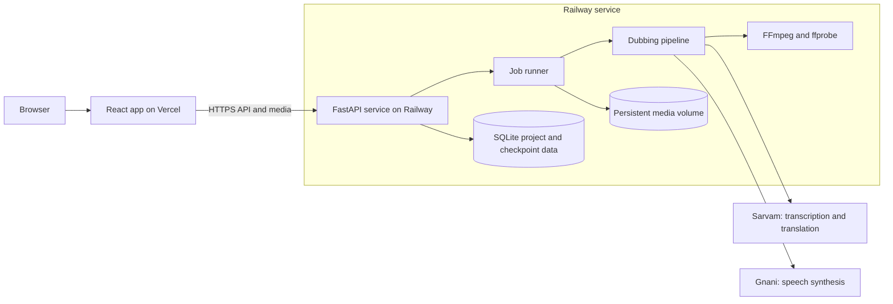
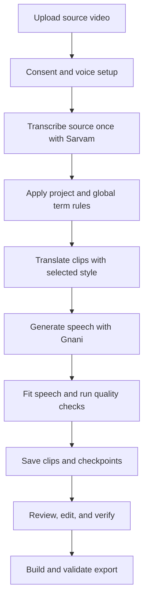

<div align="center">

# Anek

**Speak once. India understands.**

Create, review, and export dubbed videos in ten languages.

[](https://anek-tau.vercel.app)
[](https://github.com/Aarti-panchal01/anek)
[](pyproject.toml)
[](docs/GO_LIVE.md)

</div>

## Why Anek

You can dub a video into a language you can't read. That is the problem: if a price, a phone number or a name changes on the way, you won't notice.

Anek checks every dubbed clip for numbers and names, flags the ones it is unsure about, and leaves the decision to you. Nothing is fixed silently.

## Demo

Demo video coming soon.
<!-- Add the demo link here. -->

## Features

- Transcribe once, dub into up to ten languages
- Term memory for names, mishearings and pronunciation
- Verified, Review and Needs you states per clip
- A draggable timeline to fix timing by hand
- Jobs that resume after a restart

## Architecture



The frontend is hosted separately from the API. Project records and job checkpoints are stored with SQLite; uploads, takes, tracks, and exports live on the persistent Railway volume.

## Processing flow



### Provider responsibilities

| Service | Use |
| --- | --- |
| Sarvam Saaras | Source speech recognition |
| Sarvam Mayura | Translation in General or Pure style |
| Sarvam rewrite model | Shortening and translation quality retries |
| Gnani | Speech synthesis and voice services |

General keeps natural English code-switching. Pure translates ordinary English words into the target language. Protected terms and their spoken forms follow Term memory rules in either style.

## Review and timing

- Review each clip, edit its translation, generate another take, and mark the version you approve.
- Use project or global Term memory for misheard phrases, protected names, and per-language pronunciation.
- Recover long speech in this order: shorten the translation, speed it up by up to 15%, trim fixed pauses, then use a safe silent gap. A clip is withheld if it would overlap speech.
- The normal overrun tolerance is 100 ms, bounded by available silence. Clip speech must not overlap, and exports are checked against the source duration.
- Jobs save checkpoints and can resume after a restart. Project states include Processing, Interrupted, and Failed. Generated files are written atomically so partial files are not exposed.
- The editor keeps automatic attempt history, the previous and current takes, and the text changes between attempts.
- Export includes the mixed dub, subtitles, and a verification report. Projects and exports remain available until you delete the project.

## Stack

| Area | Technology |
| --- | --- |
| Web app | React, TypeScript, Vite |
| API and jobs | Python, FastAPI, Uvicorn |
| Media | FFmpeg and ffprobe |
| Data | SQLite and a Railway persistent volume |
| Hosting | Vercel and Railway |

## Run locally

Requirements: Python 3.11 or newer, Node.js 20.19 or newer (or 22.12 or newer), and FFmpeg with ffprobe on your `PATH`.

```bash
git clone https://github.com/Aarti-panchal01/anek.git
cd anek
cp .env.example .env
python -m venv .venv
```

Activate the virtual environment, then install the backend:

```bash
# macOS or Linux
source .venv/bin/activate

# Windows PowerShell
.venv\Scripts\Activate.ps1

pip install -e ".[dev]"
```

Start the API from the repository root:

```bash
uvicorn backend.app:app --reload --port 8000
```

In a second terminal, start the web app:

```bash
cd frontend
npm ci
npm run dev
```

Vite proxies `/api` and `/health` to `http://127.0.0.1:8000`. Set `VITE_API_BASE_URL` to the backend origin when the frontend uses a different API host. The app adds the `/api` prefix to requests.

For a no-cost local pipeline smoke, set `GNANI_MOCK=1` and `LLM_MOCK=1` in `.env` before starting the backend.

## Configuration

Copy `.env.example` to `.env` for local development. It contains the full list of supported settings. Keep provider keys and passwords in the backend environment, never in frontend variables or committed files.

### Vercel

| Variable | Purpose |
| --- | --- |
| `VITE_API_BASE_URL` | Railway API origin, optionally ending in `/api` |

Set Root Directory to `frontend`, Framework Preset to **Vite**, Build Command to `npm run build`, and Output Directory to `dist`.

### Railway

| Variable | Purpose |
| --- | --- |
| `GNANI_API_KEY` | Gnani speech synthesis and voice services |
| `SARVAM_API_KEY_1` to `SARVAM_API_KEY_5` | Sarvam transcription and translation; numbered keys support rotation |
| `ANEK_DATA_DIR` | Set to `/data` and mount the Railway persistent volume there |
| `CORS_ORIGINS` | Allow the production Vercel domain to call the API |
| `PRIVACY_DELETE_PASSWORD` | Protects destructive actions in Privacy settings |

For a single Sarvam key, `SARVAM_API_KEY` is supported. Optional app access protection uses `REQUIRE_ACCESS_AUTH`, `ANEK_ACCESS_PASSWORD`, and `ANEK_AUTH_SECRET`. See `.env.example` for other tuning, limits, and local mock settings.

## Deploy

### Vercel

Connect the GitHub repository and use the settings above. Set `VITE_API_BASE_URL` to the Railway service origin. Include the Vercel production domain in Railway `CORS_ORIGINS`.

### Railway

Deploy from the repository root using the included `Dockerfile` and `railway.toml`. Attach a persistent volume at `/data`; the container listens on Railway's `PORT` and defaults to `8080`. The health check is `/health`. Pushes to `main` trigger deployment when the GitHub integration is enabled.

See the [go-live guide](docs/GO_LIVE.md) for deployment and provider setup details.

## Tests

Run the backend suite from the repository root:

```bash
python -m pytest tests -q
```

Build the frontend from its directory:

```bash
cd frontend
npm ci
npm run build
```

The build runs the API-prefix check, TypeScript validation, and Vite production build. Mocked backend coverage includes Hindi and Kannada job smoke tests, media validation, timing, review state, storage, and job resume.

## Operating limits

- Uploads are limited to 100 MB and 120 seconds by default.
- Storage has a 350 MB budget and retains at most two finished projects. The oldest finished project may be removed when space is needed; active and interrupted work is preserved.
- Compatible H.264 video is retained at its original resolution. Incompatible formats may be converted once for browser playback. A failed preview conversion keeps the original upload.
- Videos currently support one speaker. Original background audio is replaced in the dubbed export.
- Speech recognition can still mishear uncommon terms. Review the transcript before approving a dub.

## Project layout

```text
anek/
├── backend/        API, providers, pipeline, checks, and served frontend build
├── frontend/       React app, Vite config, and API URL build check
├── scripts/        Provider and project diagnostics
├── tests/          Backend and pipeline tests
├── docs/           Deployment and product documentation
├── Dockerfile      Railway container build
├── railway.toml    Railway deploy and health check
└── pyproject.toml  Python dependencies and pytest settings
```

## Credits

### Product and design

Anek is built by [Aarti Panchal](https://aarti-panchal.site).

### Services

| Contribution | Provider |
| --- | --- |
| Speech synthesis and voice services | Gnani |
| Source speech recognition and translation | Sarvam |

### Open-source software

Anek is built with React, TypeScript, Vite, FastAPI, Python, and FFmpeg. The dependency manifests are [pyproject.toml](pyproject.toml) and [frontend/package.json](frontend/package.json).
