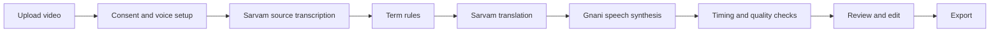

<div align="center">

# Anek

**Speak once. India understands.**

Create, review, and export dubbed videos in ten languages.

[](https://anek-tau.vercel.app)
[](https://github.com/Aarti-panchal01/anek)
[](pyproject.toml)
[](docs/GO_LIVE.md)

</div>

## What Anek does

Anek turns a single-speaker video into reviewed dubbed versions. It transcribes the source once, applies project terminology, translates and voices each clip, checks timing, and gives you control over edits and approval before export.

Available targets are Bengali, English, Gujarati, Hindi, Kannada, Malayalam, Marathi, Punjabi, Tamil, and Telugu.

## How a dub is made



### Provider responsibilities

| Service | Use |
| --- | --- |
| Sarvam Saaras | Source speech recognition |
| Sarvam Mayura | Translation in General or Pure style |
| Sarvam rewrite model | Shortening and translation quality retries |
| Gnani | Speech synthesis and voice services |

General keeps natural English code-switching. Pure translates ordinary English words into the target language. Protected terms and their spoken forms follow Term memory rules in either style.

## Review and timing

- Review each clip, edit its translation, generate another take, and mark the version you approve.
- Use project or global Term memory for misheard phrases, protected names, and per-language pronunciation.
- Recover long speech in this order: shorten the translation, speed it up by up to 15%, trim fixed pauses, then use a safe silent gap. A clip is withheld if it would overlap speech.
- The normal overrun tolerance is 100 ms, bounded by available silence. Clip speech must not overlap, and exports are checked against the source duration.
- Jobs save checkpoints and can resume after a restart. Project states include Processing, Interrupted, and Failed. Generated files are written atomically so partial files are not exposed.
- The editor keeps automatic attempt history, the previous and current takes, and the text changes between attempts.
- Export includes the mixed dub, subtitles, and a verification report. Exports expire after 24 hours by default.

## Stack

| Area | Technology |
| --- | --- |
| Web app | React, TypeScript, Vite |
| API and jobs | Python, FastAPI, Uvicorn |
| Media | FFmpeg and ffprobe |
| Data | SQLite and a Railway persistent volume |
| Hosting | Vercel and Railway |

## Run locally

Requirements: Python 3.11 or newer, Node.js 20.19 or newer (or 22.12 or newer), and FFmpeg with ffprobe on your `PATH`.

```bash
git clone https://github.com/Aarti-panchal01/anek.git
cd anek
cp .env.example .env
python -m venv .venv
```

Activate the virtual environment, then install the backend:

```bash
# macOS or Linux
source .venv/bin/activate

# Windows PowerShell
.venv\Scripts\Activate.ps1

pip install -e ".[dev]"
```

Start the API from the repository root:

```bash
uvicorn backend.app:app --reload --port 8000
```

In a second terminal, start the web app:

```bash
cd frontend
npm ci
npm run dev
```

Vite proxies `/api` and `/health` to `http://127.0.0.1:8000`. Set `VITE_API_BASE_URL` to the backend origin when the frontend uses a different API host. The app adds the `/api` prefix to requests.

For a no-cost local pipeline smoke, set `GNANI_MOCK=1` and `LLM_MOCK=1` in `.env` before starting the backend.

## Configuration

Copy `.env.example` to `.env` for local development. Set production secrets in Railway, not in the frontend or repository.

### Vercel

| Variable | Purpose |
| --- | --- |
| `VITE_API_BASE_URL` | Railway API origin, optionally ending in `/api` |

Set the Vercel Root Directory to `frontend`, Framework Preset to **Vite**, Build Command to `npm run build`, and Output Directory to `dist`.

### Railway

| Variable | Purpose |
| --- | --- |
| `GNANI_API_KEY` | Gnani speech synthesis and voice services |
| `GNANI_BASE_URL` | Gnani API host |
| `SARVAM_API_KEY_1`, `SARVAM_API_KEY_2`, `SARVAM_API_KEY_3`, `SARVAM_API_KEY_4`, `SARVAM_API_KEY_5` | Sarvam keys; rotate across configured keys when a key is rejected or quota-limited |
| `SARVAM_API_KEY` | Single-key fallback when numbered keys are not configured |
| `SARVAM_TRANSLATION_MODEL` | Translation model; defaults to `mayura:v1` |
| `SARVAM_REWRITE_MODEL` | Rewrite and quality retry model |
| `ANEK_DATA_DIR` | Database and project data directory; mount the persistent volume here |
| `REQUIRE_ACCESS_AUTH` | Enables the app access gate |
| `ANEK_ACCESS_PASSWORD` | Password for the app access gate when enabled |
| `ANEK_AUTH_SECRET` | Signs app access tokens |
| `PRIVACY_DELETE_PASSWORD` | Required by destructive Privacy actions |
| `CORS_ORIGINS` | Comma-separated allowed frontend origins; include the deployed Vercel domain |
| `CORS_ORIGIN_REGEX` | Optional allowed-origin pattern for preview deployments |
| `MAX_VIDEO_SECONDS` | Maximum accepted video duration, up to 120 seconds |
| `EXPORT_RETENTION_HOURS` | How long generated exports are kept |
| `GNANI_DAILY_LIMIT` | Daily speech-service credit limit |
| `MAX_CREDITS_PER_JOB` | Optional per-job credit cap; `0` disables this cap |
| `PER_IP_LIMITS` | Per-IP limits for voice cloning, previews, and jobs |
| `APP_NAME` | App name shown by the API |
| `NUMERAL_STYLE` | Default numeral style in generated text |
| `ENABLED_LANGS` | Comma-separated language codes enabled by the service |
| `LOW_TRUST_VERIFY_LANGS` | Languages requiring stricter review checks |
| `FIT_TOLERANCE` | Text-length timing estimate multiplier |
| `MAX_STRETCH` | Maximum legacy timing stretch ratio |
| `SIMILARITY_THRESHOLD` | Similarity threshold for quality checks |
| `CONSENT_MATCH_THRESHOLD` | Voice-consent match threshold |
| `GNANI_MOCK` | Uses mocked Gnani responses for local testing only |
| `LLM_MOCK` | Uses mocked translation responses for local testing only |

Timing behavior also uses a 100 ms overrun tolerance, up to 15% audio speed-up, and silent-gap spill when it does not overlap speech.

## Deploy

### Vercel

Connect the GitHub repository and use the settings above. Set `VITE_API_BASE_URL` to the Railway service origin. Include the Vercel production domain in Railway `CORS_ORIGINS`.

### Railway

Deploy from the repository root using the included `Dockerfile` and `railway.toml`. Attach a persistent volume at `/data`; the container listens on Railway's `PORT` and defaults to `8080`. The health check is `/health`. Pushes to `main` trigger deployment when the GitHub integration is enabled.

See the [go-live guide](docs/GO_LIVE.md) for deployment and provider setup details.

## Tests

Run the backend suite from the repository root:

```bash
python -m pytest tests -q
```

Build the frontend from its directory:

```bash
cd frontend
npm ci
npm run build
```

The build runs the API-prefix check, TypeScript validation, and Vite production build. Mocked backend coverage includes Hindi and Kannada job smoke tests, media validation, timing, review state, storage, and job resume.

## Operating limits

- Uploads are limited to 100 MB and 120 seconds by default.
- Storage has a 350 MB budget and retains at most two finished projects. The oldest finished project may be removed when space is needed; active and interrupted work is preserved.
- Compatible H.264 video is retained at its original resolution. Incompatible formats may be converted once for browser playback. A failed preview conversion keeps the original upload.
- Videos currently support one speaker. Original background audio is replaced in the dubbed export.
- Speech recognition can still mishear uncommon terms. Review the transcript before approving a dub.

## Project layout

```text
backend/       FastAPI app, provider clients, pipeline, checks, and static build
frontend/      React and TypeScript app, Vite config, and API-prefix build check
scripts/       Provider and project diagnostics
tests/         Backend API, pipeline, timing, and resilience tests
docs/          Deployment and product documentation
Dockerfile     Railway image build
railway.toml   Railway build and health-check settings
pyproject.toml Python dependencies and pytest configuration
```

## Credits

### Product and design

Anek is built by [Aarti Panchal](https://aarti-panchal.site).

### Services

| Contribution | Provider |
| --- | --- |
| Speech synthesis and voice services | Gnani |
| Source speech recognition and translation | Sarvam |

### Open-source software

Anek is built with React, TypeScript, Vite, FastAPI, Python, and FFmpeg. The dependency manifests are [pyproject.toml](pyproject.toml) and [frontend/package.json](frontend/package.json).
